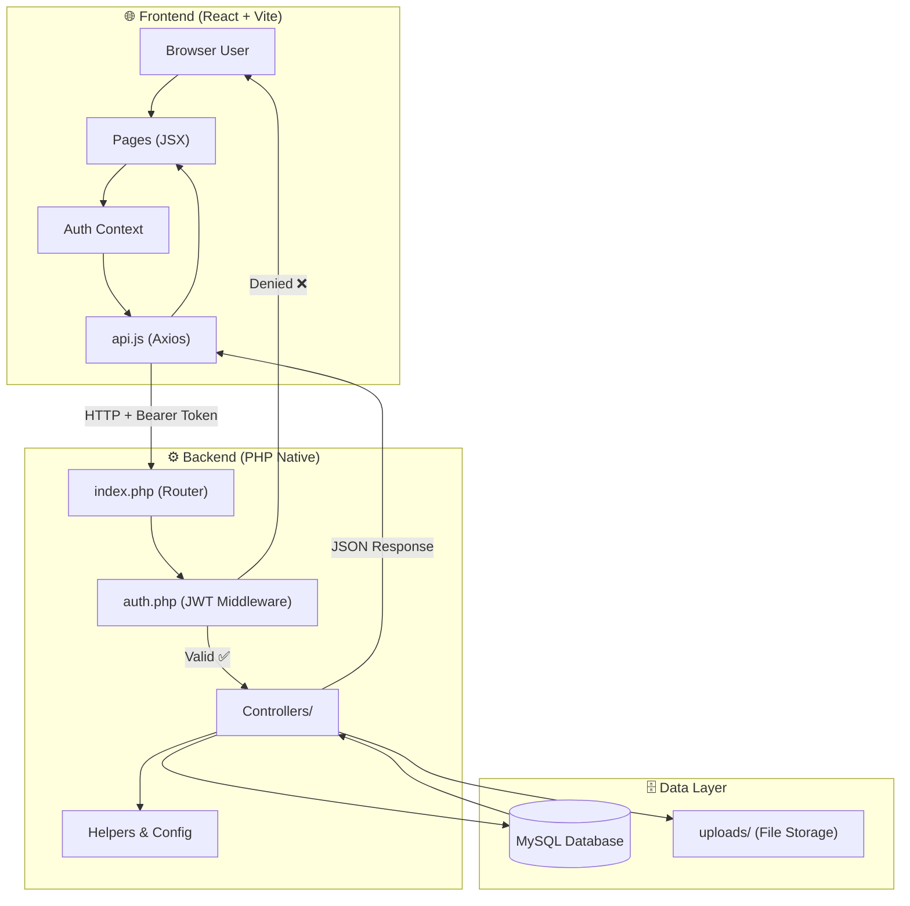
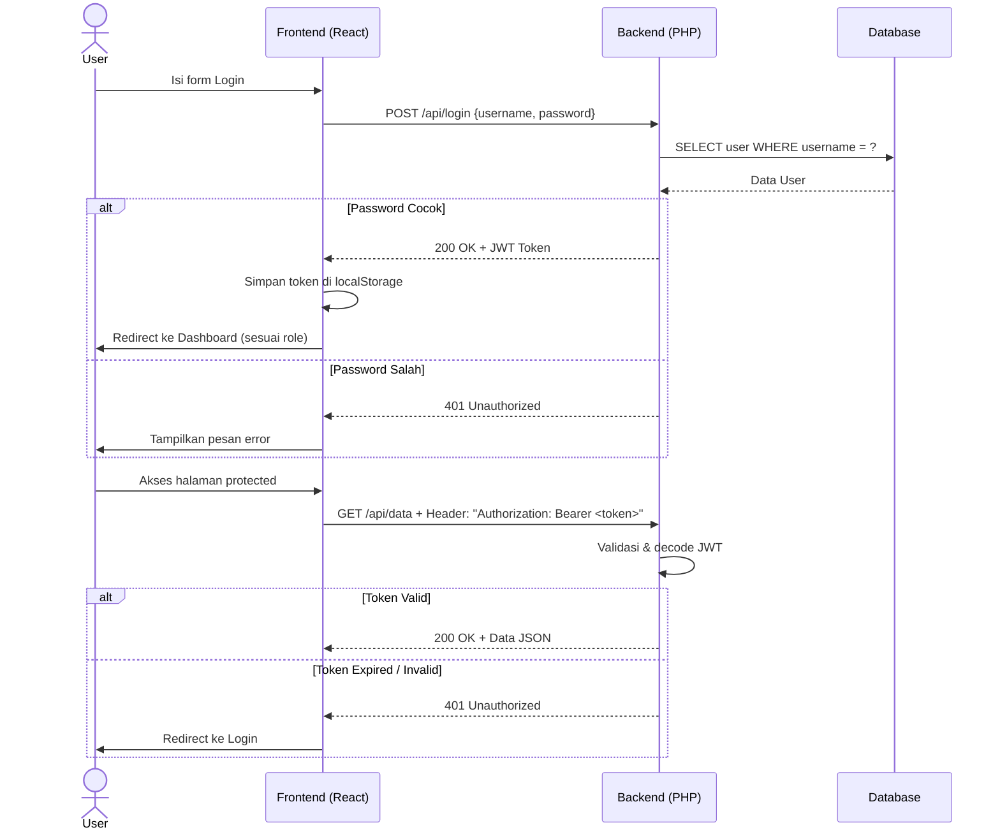
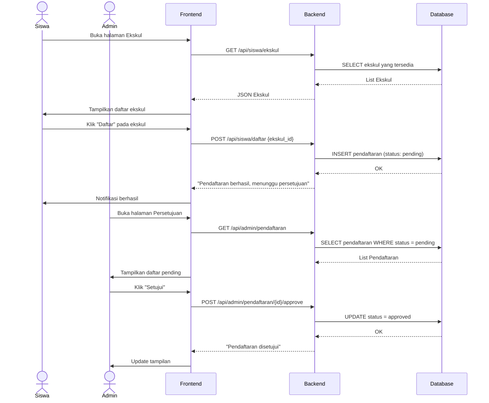
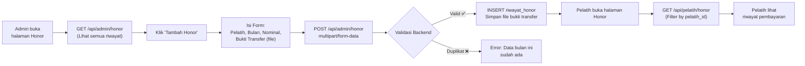
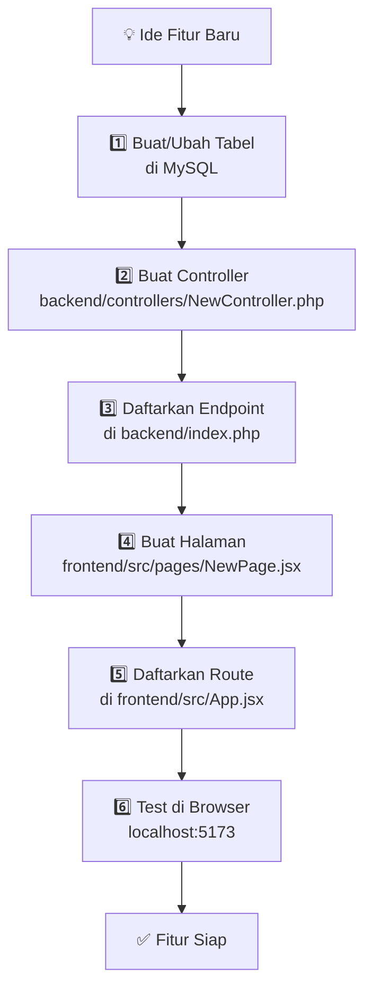

# SIKASA — Workflow Documentation

Dokumen ini berisi gambaran alur kerja sistem **SIKASA** dalam bentuk diagram.

---

## 1. Arsitektur Sistem

---

## 2. Alur Autentikasi (JWT)

---

## 3. Workflow Per Peran (Role)

```mermaid
graph TD
    Login["🔐 Login"]
    Login --> RoleCheck{Cek Role}

    RoleCheck -->|admin| AdminDash["📊 Admin Dashboard"]
    RoleCheck -->|pelatih| PelatihDash["🏋️ Pelatih Dashboard"]
    RoleCheck -->|siswa| SiswaDash["🎒 Siswa Dashboard"]
    RoleCheck -->|pendamping| GuruDash["👨‍🏫 Guru Dashboard"]
    RoleCheck -->|orang_tua| OrtaDash["👪 Orang Tua Dashboard"]
    RoleCheck -->|kepala_sekolah| KepalaSekolahDash["🏫 Kepala Sekolah"]

    AdminDash --> A1["Kelola Kelas"]
    AdminDash --> A2["Kelola Ekskul"]
    AdminDash --> A3["Kelola Siswa / Guru / Pelatih"]
    AdminDash --> A4["Persetujuan Pendaftaran"]
    AdminDash --> A5["Honor Pelatih"]
    AdminDash --> A6["Monitoring Absensi & Nilai"]
    AdminDash --> A7["Data Orang Tua"]

    PelatihDash --> P1["Lihat Daftar Siswa Ekskul"]
    PelatihDash --> P2["Input Absensi Pertemuan"]
    PelatihDash --> P3["Input Nilai Siswa"]
    PelatihDash --> P4["Lihat Riwayat Honor"]

    SiswaDash --> S1["Daftar Ekskul"]
    SiswaDash --> S2["Ajukan Izin Absen"]
    SiswaDash --> S3["Lihat Kehadiran"]
    SiswaDash --> S4["Lihat Info Lomba"]

    GuruDash --> G1["Monitor Absensi"]
    GuruDash --> G2["Bantu Input Nilai"]

    OrtaDash --> O1["Lihat Absensi Anak"]
    OrtaDash --> O2["Lihat Nilai Anak"]
    OrtaDash --> O3["Lihat Lomba Anak"]
    OrtaDash --> O4["Ajukan Pengunduran Diri Ekskul"]

    KepalaSekolahDash --> K1["Monitoring Absensi Global"]
    KepalaSekolahDash --> K2["Laporan Honor Pelatih"]
    KepalaSekolahDash --> K3["Data Lomba Siswa"]
```

---

## 4. Alur Pendaftaran Ekskul (Contoh Workflow Data)

---

## 5. Alur Honor Pelatih

---

## 6. Alur Pengembangan Fitur Baru

---

## 7. Peta Endpoint API

| Peran | Endpoint | Method | Fungsi |
|---|---|---|---|
| Public | `/api/login` | POST | Login & dapat JWT Token |
| Admin | `/api/admin/dashboard` | GET | Data statistik dashboard |
| Admin | `/api/admin/siswa` | GET/POST | CRUD data siswa |
| Admin | `/api/admin/ekskul` | GET/POST/PUT/DELETE | Kelola ekskul |
| Admin | `/api/admin/pendaftaran/{id}/approve` | POST | Setujui pendaftaran |
| Admin | `/api/admin/honor` | GET/POST | Kelola honor pelatih |
| Admin | `/api/admin/monitoring` | GET | Rekapitulasi absensi global |
| Pelatih | `/api/pelatih/dashboard` | GET | Dashboard pelatih |
| Pelatih | `/api/pelatih/absensi` | GET/POST | Input & lihat absensi |
| Pelatih | `/api/pelatih/nilai` | GET/POST | Input & lihat nilai |
| Pelatih | `/api/pelatih/honor` | GET | Riwayat honor |
| Siswa | `/api/siswa/dashboard` | GET | Dashboard siswa |
| Siswa | `/api/siswa/daftar` | POST | Daftar ekskul |
| Siswa | `/api/siswa/izin` | POST | Ajukan izin absen |
| Siswa | `/api/siswa/kehadiran` | GET | Lihat history kehadiran |
| Orang Tua | `/api/parent/children` | GET | Lihat data anak |
| Orang Tua | `/api/parent/child/{id}/absensi` | GET | Absensi anak |
